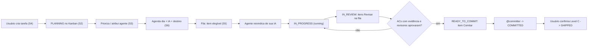
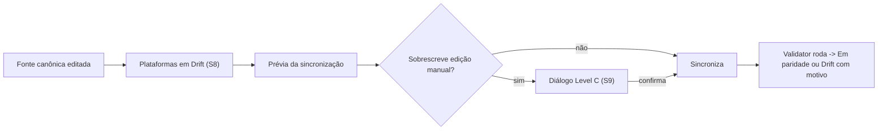

# PRD — Harness Hub (Visual Hub + Multi-AI Adapter)

**Data:** 2026-11-23
**Autor:** `@product-manager`
**Status do documento:** pronto para `@tech-lead` (HOW)
**Fontes:** `.specs/docs/research-devworks-harness.md`, `CLAUDE.md`, `AGENTS.md`, `.claude/rules/10-orchestration.md`, `.claude/rules/30-autonomy.md`, `.claude/templates/task.md`, `.specs/harness/incidents.jsonl` (44 linhas hoje), `.specs/logs/gate-*.log`.

> Este documento define **O QUÊ** e **POR QUÊ**. Não define stack, contratos de API, formatos de arquivo nem nomes de arquivo — isso é responsabilidade do `@tech-lead`. Onde um requisito toca uma decisão técnica, ele descreve o comportamento observável e deixa o "como" em aberto.

---

## 1. Visão do Produto

O **Harness Hub** é o painel de controle visual local do nosso harness de 14 agentes. Em uma única aplicação aberta no navegador da própria máquina, o usuário (o "dono do harness") vê **o que está rodando, o que está na fila, o que está priorizado, o que está agendado para cada dia da semana, o que está sendo corrigido e o que está sendo prototipado** — e age sobre isso (criar, priorizar, delegar, mover tarefas) sem editar Markdown à mão.

Ao mesmo tempo, o Hub torna o harness **agnóstico de IA**: a mesma fonte canônica de regras, agentes e skills é projetada para **Antigravity, Claude Code, Codex e Cursor**, com um indicador de paridade que acusa qualquer divergência (drift).

**Princípio inegociável:** os arquivos do repositório continuam sendo a fonte única de verdade. O Hub lê e escreve neles; quem trabalha pela IDE/CLI e quem trabalha pelo Hub enxerga o mesmo estado.

## 2. Problema (JTBD)

**Quem:** o desenvolvedor dono do harness que coordena o Maestro e os 14 agentes em uma ou mais IAs (hoje: usuário único, Windows nativo).

**Job principal:**
> *Quando eu tenho várias tarefas em andamento com vários agentes e IAs, eu quero ver e controlar em um só lugar o estado, a prioridade e o agendamento de tudo, para que eu delegue com confiança e nenhum trabalho trave, se perca ou viole as regras do time.*

**Jobs secundários:**
1. *Quando eu abro o dia*, quero saber em poucos segundos o que está rodando, bloqueado e aguardando minha decisão.
2. *Quando surge trabalho novo*, quero criar e priorizar uma tarefa e saber qual agente vai pegá-la a seguir.
3. *Quando planejo a semana*, quero atribuir tarefas a dias, agentes e IAs.
4. *Quando troco de IA* (ex.: Claude → Cursor), quero que as regras do time estejam idênticas lá, sem copiar arquivo à mão.

**Hoje (situação atual):**
- O estado vive em `## Status:` de arquivos de tarefa Markdown e no histórico de chat; não há visão agregada. (Observação: a pasta de tarefas ainda nem existe neste repo — o Hub precisa lidar com o estado vazio.)
- O arquivo de tarefa não tem campo de **prioridade**, **agente responsável** nem **agendamento**; isso é decidido de cabeça.
- Invariantes do time (só `@committer` comita, autor não revisa o próprio T2+, transições válidas, Level C pede aprovação) dependem de disciplina — nada visual as impede.
- Saúde do harness (validator, selftest, incidentes) só aparece rodando comandos.
- Só o Claude Code consome as regras nativamente; Antigravity, Codex e Cursor exigem cópia manual (risco de drift).

**Por que agora:** o roster chegou a 14 agentes e a pesquisa (`research-devworks-harness.md` §2.2) mostrou que a referência mais próxima cobre apenas uma lista linear de fases, sem backlog, prioridade, agenda nem multi-agente — o espaço não está atendido.

## 3. Objetivos de Sucesso (mensuráveis)

| # | Objetivo | Métrica / sinal de aceite | Meta MVP | Baseline |
|---|----------|---------------------------|----------|----------|
| O1 | Visibilidade instantânea | Tempo do Hub aberto até o usuário responder "o que está rodando, bloqueado e aguardando decisão" sem sair da tela inicial | ≤ 10 s, 0 cliques | TBD — medir com 3 sessões cronometradas antes/depois |
| O2 | Integridade do ciclo de vida | % de mudanças de status feitas pelo Hub que resultam em arquivo de tarefa válido pelo validador de tarefas do harness | 100 % | n/a (novo) |
| O3 | Invariantes garantidas | Nº de transições proibidas (seção 8) aceitas pelo Hub em teste de regressão | 0 | n/a |
| O4 | Fonte única de verdade | Tempo entre editar um arquivo de tarefa fora do Hub e o Hub refletir a mudança | ≤ 5 s | n/a |
| O5 | Paridade Multi-AI | Plataformas em estado "Em paridade" após uma sincronização | 4 de 4 | 1 de 4 (só Claude Code nativo) |
| O6 | Harness continua verde | Validator e selftest do harness após instalar o Hub e sincronizar projeções | exit 0 em ambos | exit 0 (validator PASS com 1 warning hoje) |
| O7 | Demanda consumível por agentes | Agente em qualquer uma das 4 IAs consegue obter e reivindicar o próximo item elegível da sua função sem ajuda humana | 1 fluxo ponta-a-ponta comprovado por IA instalada | 0 |

## 4. Corte de Escopo (MoSCoW)

### MUST — MVP (protótipo funcional conectado ao filesystem real, rodável agora)

| Módulo | Inclui |
|--------|--------|
| **M1 Mission Control** | KPIs por status, WIP, bloqueadas, P0 abertas, progresso de ACs, saúde dos gates (validator + selftest) com execução sob demanda, aguardando decisão do usuário, resumo de paridade Multi-AI, feed de atividade. |
| **M2 Kanban & Backlog** | Colunas do ciclo real; criar tarefa; editar prioridade (P0–P3), agente, revisor, tier, tipo; drag & drop com validação de transição; bloquear/desbloquear/cancelar/superseder; drawer de detalhe (problema, ACs + evidência, arquivos, slices, log). |
| **M3 Fila de Demanda** | Lista ordenada do que cada agente pega a seguir, com regras de elegibilidade visíveis e motivo de inelegibilidade; reivindicação (claim) atômica por um agente de qualquer IA suportada. |
| **M4 Agenda Semanal** | Grade Seg–Dom navegável por semana; arrastar tarefa para um dia; definir agente, IA alvo e destino; impacto do agendamento na fila. |
| **M5 Monitor de Agentes** | Os agentes do roster com estado Ativo / Idle / Bloqueado, tarefa atual, modelo, IA em uso, incidentes abertos do harness. |
| **M6 Hub Multi-AI** | 4 plataformas (Antigravity, Claude Code, Codex, Cursor): detecção de instalação, status de paridade/drift por plataforma, lista de itens divergentes, sincronização a partir da fonte canônica com confirmação para sobrescritas. |
| **Transversal** | Sincronia com edições externas; estados empty/loading/error/blocked/running; acesso somente pela própria máquina; funciona em Windows nativo (e também macOS/Linux). |

### SHOULD — Fase 2

- **Runner autônomo**: o Hub dispara agentes nas CLIs (modo implementação / verificação) a partir da fila, com failover entre IAs por limite de uso (inspirado no loop de execução da referência, §4 da pesquisa).
- **Logs ao vivo** por agente com auto-follow, busca e filtro; botão Stop seguro.
- **Responder decisões Level C pelo Hub** (aprovar/recusar push, PR, deploy) com trilha de auditoria.
- **Agenda recorrente** (rotinas semanais, ex.: "toda segunda `@tech-writer` atualiza docs") e disparo automático no horário.
- Roteamento de IA/modelo por perfil de agente (Planning / Build / Review / Scout) com fila de prioridade de modelos.
- Busca global e filtros salvos; atalhos de teclado.
- Métricas históricas (lead time por status, throughput semanal).

### COULD — Later

- Modo light/dark com preferência persistida (dark é o padrão no MVP).
- Notificações do sistema operacional.
- Exportar relatório semanal em Markdown.
- Suporte a outras IAs (ex.: OpenCode) via o mesmo mecanismo de projeção.

### WON'T — Fora de Escopo (explícito)

- Executar `git push`, abrir/mergear PR, deploy, ou qualquer ação Level C **a partir do Hub** no MVP.
- Commitar pelo Hub (o commit continua exclusivo do `@committer`).
- Apagar arquivos de tarefa pelo Hub (encerramento é por `CANCELLED`/`SUPERSEDED`).
- Multiusuário, login, permissões, acesso remoto/hospedagem em nuvem.
- Banco de dados como fonte de verdade.
- Editar regras/agentes/skills canônicos pelo Hub (o Hub só **projeta**; edição continua na IDE).
- Disparar agentes automaticamente (é Fase 2); no MVP os agentes **consultam e reivindicam** a fila a partir das suas próprias sessões.
- App mobile.

---

## 5. Personas e Atores

| Ator | Descrição |
|------|-----------|
| **Usuário (dono do harness)** | Humano único. Cria, prioriza, agenda, aprova Level C. |
| **Maestro** | Thread principal em qualquer IA; faz triagem e delega. Consulta a fila. |
| **Agente** | Um dos 14 do roster, rodando em Antigravity, Claude Code, Codex ou Cursor. Reivindica itens da fila compatíveis com sua função. |
| **`@committer`** | Único ator que leva uma tarefa a `COMMITTED`. |

---

## 6. Histórias de Usuário do MVP

Convenções: **P** = prioridade (P0 mais alta). "Tarefa" = arquivo de tarefa do harness. Cada AC é verificável por teste automatizado ou checagem manual objetiva.

### Módulo M1 — Mission Control

#### HU-01 — Ver o estado geral do harness em uma tela
**Como** usuário, **quero** abrir o Hub e ver os números do harness numa tela só, **para** saber em segundos o que está rodando, bloqueado e aguardando minha decisão.

- **AC-01.1** Ao abrir o Hub, a tela inicial é o Mission Control.
- **AC-01.2** Existe um contador por status (`PLANNING`, `IN_PROGRESS`, `IN_REVIEW`, `READY_TO_COMMIT`, `COMMITTED`, `SHIPPED`, `BLOCKED`, `CANCELLED`, `SUPERSEDED`) e cada número é igual à quantidade de tarefas com aquele status nos arquivos (verificável criando N tarefas de teste por status e comparando).
- **AC-01.3** O card "Em execução" mostra o número de tarefas `IN_PROGRESS` + `IN_REVIEW` que estão reivindicadas por um agente, e lista no máximo 5 com título, agente, IA e tempo decorrido desde a reivindicação (formato `hh:mm`).
- **AC-01.4** O card "Bloqueadas" mostra a contagem de tarefas `BLOCKED(...)` e, para cada uma, o motivo exatamente como escrito no arquivo.
- **AC-01.5** O card "Aguardando você" conta tarefas com a seção *Needs from user* não vazia **ou** status `BLOCKED` cujo motivo foi marcado como decisão do usuário; clicar abre a lista filtrada no Kanban.
- **AC-01.6** O card "P0 abertas" conta tarefas com prioridade P0 e status não terminal (terminais: `SHIPPED`, `CANCELLED`, `SUPERSEDED`).
- **AC-01.7** O card "Progresso de ACs" exibe `X/Y` onde Y = total de critérios de aceite em tarefas não terminais e X = os marcados como concluídos.
- **AC-01.8** O card "Paridade Multi-AI" exibe `K/4 em paridade` com o mesmo valor calculado na tela Hub Multi-AI (HU-14).
- **AC-01.9** O feed "Atividade recente" lista os últimos 20 eventos (criação, mudança de status, reivindicação, mudança de prioridade/agente, sincronização, execução de gate) em ordem decrescente de horário, cada um com horário, ator (usuário ou `@agente` + IA) e descrição.
- **AC-01.10** Com zero tarefas, todos os contadores mostram 0 e aparece o estado vazio com o botão "Criar primeira tarefa" (ver §9).

#### HU-02 — Ver e rodar os gates do harness
**Como** usuário, **quero** ver o resultado dos gates do harness e rodá-los com um clique, **para** saber se o harness está saudável antes de delegar.

- **AC-02.1** O painel "Gates" lista cada linha da tabela *Verification* do projeto (hoje: `harness`, `selftest`) com nome, comando, baseline, último resultado (`PASS` / `FAIL` / `Nunca executado`) e horário da última execução.
- **AC-02.2** Adicionar ou remover uma linha na tabela *Verification* faz o painel refletir a mudança sem reiniciar o Hub (a lista não é fixa no Hub).
- **AC-02.3** O botão "Rodar" de um gate executa o comando daquela linha; durante a execução o gate fica em estado *running* e o botão fica desabilitado.
- **AC-02.4** Ao terminar, o resultado é `PASS` se o critério de baseline foi atendido e `FAIL` caso contrário; o resultado bate com rodar o mesmo comando manualmente no terminal.
- **AC-02.5** Em `FAIL`, o painel exibe as últimas 50 linhas da saída do comando.
- **AC-02.6** Contagem de warnings do validator é exibida quando presente (hoje: 1 warning).
- **AC-02.7** Um gate que exceda 5 minutos é marcado como `FAIL (timeout)` e o processo é encerrado.

### Módulo M2 — Kanban & Backlog

#### HU-03 — Ver o Kanban com o ciclo real
**Como** usuário, **quero** ver todas as tarefas em colunas que espelham o ciclo de vida do harness, **para** entender o fluxo de trabalho de relance.

- **AC-03.1** O Kanban tem exatamente estas colunas, nesta ordem: `PLANNING`, `IN_PROGRESS`, `IN_REVIEW`, `READY_TO_COMMIT`, `COMMITTED`, `SHIPPED`; mais a raia **Bloqueadas** (tarefas `BLOCKED(...)`) e a área recolhível **Encerradas** (`CANCELLED` e `SUPERSEDED`), recolhida por padrão.
- **AC-03.2** Cada tarefa aparece em exatamente uma coluna/raia, de acordo com o status no arquivo.
- **AC-03.3** Uma tarefa `BLOCKED(IN_REVIEW): motivo` aparece na raia Bloqueadas com a etiqueta "estava em IN_REVIEW" e o motivo.
- **AC-03.4** Cada card mostra: título, prioridade (P0–P3), tier, tipo, agente responsável (ou "Sem agente"), IA alvo (ou "—"), progresso de ACs `X/Y`, e dia agendado (ou nada).
- **AC-03.5** Cards de tipo **Bug** e **Hotfix** exibem selo "Correção"; cards de tipo **Prototype** exibem selo "Protótipo"; cards reivindicados exibem indicador *running* com o tempo decorrido.
- **AC-03.6** Dentro de cada coluna, os cards são ordenados por prioridade (P0 primeiro) e, em empate, pela ordem manual definida pelo usuário (HU-05).
- **AC-03.7** Filtros por agente, prioridade, tier, tipo e IA alvo combinam-se com E lógico; com filtro ativo, cada coluna mostra "N de M".
- **AC-03.8** Uma tarefa cujo arquivo não pode ser interpretado aparece como card **Inválido** na coluna `PLANNING` com a mensagem de erro e o caminho do arquivo; ela nunca é ocultada silenciosamente.

#### HU-04 — Criar tarefa pelo Hub
**Como** usuário, **quero** criar uma tarefa por um formulário, **para** colocar trabalho novo no backlog sem escrever Markdown.

- **AC-04.1** O botão "Nova tarefa" abre um formulário com: título (obrigatório), problema, critérios de aceite (lista, ≥ 1 obrigatório para T2/T3/Hotfix), fora de escopo, tier (T2, T3, Hotfix, Prototype; padrão T2), tipo (Feature, Bug, Hotfix, Prototype, Docs, Ops, Harness; padrão Feature), prioridade (P0–P3; padrão P2), agente responsável (opcional), revisor (opcional), origem (texto livre).
- **AC-04.2** Salvar com título vazio é impedido e o campo é sinalizado com a mensagem "Título obrigatório".
- **AC-04.3** Ao salvar, um novo arquivo de tarefa é criado no local padrão de tarefas do harness, com status `PLANNING`, seguindo o modelo de tarefa do harness, e o card aparece na coluna `PLANNING` em ≤ 2 s.
- **AC-04.4** O arquivo criado é aceito pelo validador de tarefas do harness (o mesmo comando documentado em `CLAUDE.md`), ou o Hub mostra os erros do validador no card e não o trata como elegível para a fila.
- **AC-04.5** Dois títulos iguais geram dois arquivos distintos; nenhum arquivo existente é sobrescrito.
- **AC-04.6** Se a pasta de tarefas não existir, ela é criada na primeira tarefa.
- **AC-04.7** A criação gera um evento no feed de atividade (AC-01.9).

#### HU-05 — Editar prioridade, agente, revisor, tier e tipo
**Como** usuário, **quero** alterar os atributos de planejamento de uma tarefa, **para** decidir quem faz o quê e em que ordem.

- **AC-05.1** No drawer da tarefa, prioridade, agente responsável, revisor, IA alvo, tier e tipo são editáveis; a alteração persiste e sobrevive a reiniciar o Hub.
- **AC-05.2** As opções de agente são exatamente os agentes do roster em `AGENTS.md` (hoje 14); um agente adicionado ao roster aparece na lista sem alteração no Hub.
- **AC-05.3** Para tier T2, T3 ou Hotfix, escolher como revisor o mesmo agente que é o responsável é recusado com a mensagem "O autor não revisa o próprio trabalho T2+".
- **AC-05.4** `@committer` não pode ser escolhido como agente responsável nem como revisor (mensagem: "`@committer` só atua em READY_TO_COMMIT").
- **AC-05.5** O usuário pode reordenar cards por arrastar dentro da mesma coluna e mesma prioridade; a ordem persiste.
- **AC-05.6** Alterar atributos de planejamento não altera o conteúdo das seções do arquivo de tarefa usadas pelo validador (o validador retorna o mesmo resultado antes e depois).
- **AC-05.7** Uma tarefa sem prioridade registrada (ex.: criada fora do Hub) é exibida como P2.
- **AC-05.8** Promover um Prototype para T2 ou T3 é permitido e registra o evento "promovido" no log da tarefa.

#### HU-06 — Mover tarefas entre colunas (drag & drop) respeitando o ciclo
**Como** usuário, **quero** arrastar um card para outra coluna, **para** atualizar o status sem editar o arquivo.

- **AC-06.1** Soltar um card numa coluna permitida pela matriz de transições (§8.2) atualiza o `## Status:` do arquivo em ≤ 2 s e registra a mudança no log da tarefa com data, ator e status anterior → novo.
- **AC-06.2** Durante o arraste, colunas de destino proibidas ficam visualmente desabilitadas; soltar numa coluna proibida devolve o card à origem e mostra a regra violada (texto da §8.2).
- **AC-06.3** Arrastar para `COMMITTED` é sempre recusado pelo usuário humano com a mensagem "Somente `@committer` move para COMMITTED".
- **AC-06.4** Arrastar de `PLANNING` para `IN_PROGRESS` é recusado se o validador de tarefas reprovar o arquivo, exibindo os erros.
- **AC-06.5** Arrastar de `IN_REVIEW` para `READY_TO_COMMIT` é recusado se: (a) algum AC não estiver marcado com evidência preenchida; ou (b) faltar aprovação registrada de algum revisor obrigatório do tier (§8.3); ou (c) o revisor registrado for o próprio autor em T2+. A mensagem lista o(s) item(ns) faltante(s).
- **AC-06.6** Arrastar de `COMMITTED` para `SHIPPED` abre o diálogo de confirmação Level C (§8.4); cancelar o diálogo mantém o card em `COMMITTED`.
- **AC-06.7** Prototype não pode ir para `READY_TO_COMMIT` sem antes ser promovido (mensagem: "Protótipo não é comitado — promova para T2/T3").
- **AC-06.8** Cards em `SHIPPED`, `CANCELLED` ou `SUPERSEDED` não podem ser arrastados.
- **AC-06.9** O drag & drop tem alternativa por teclado/menu ("Mover para…") que aplica exatamente as mesmas regras.

#### HU-07 — Bloquear, desbloquear, cancelar e superseder
**Como** usuário, **quero** marcar trabalho como bloqueado ou encerrado com motivo, **para** que o estado reflita a realidade e possa ser retomado.

- **AC-07.1** "Bloquear" exige motivo não vazio e um marcador "decisão do usuário: sim/não"; grava `BLOCKED(<status anterior>): <motivo>`.
- **AC-07.2** "Desbloquear" restaura exatamente o status entre parênteses; não há opção de escolher outro status.
- **AC-07.3** "Cancelar" pede confirmação e grava `CANCELLED`; o card vai para Encerradas.
- **AC-07.4** "Superseder" exige escolher outra tarefa existente e grava `SUPERSEDED: <referência da tarefa escolhida>`; escolher a própria tarefa é recusado.
- **AC-07.5** Nenhuma dessas ações apaga o arquivo de tarefa.

#### HU-08 — Ver detalhes da tarefa
**Como** usuário, **quero** abrir uma tarefa e ver tudo dela, **para** avaliar progresso e evidência sem abrir o editor.

- **AC-08.1** Clicar num card abre um drawer lateral sem sair do Kanban; `Esc` ou "Fechar" o fecha.
- **AC-08.2** O drawer mostra: status, título, origem, prova, problema, critérios de aceite com marcação e evidência, fora de escopo, arquivos, slices (quando houver), decisões tomadas, *needs from user*, log — com o mesmo conteúdo do arquivo.
- **AC-08.3** Marcar/desmarcar um AC no drawer altera a marcação no arquivo; marcar exige evidência não vazia (mensagem: "Evidência obrigatória").
- **AC-08.4** O drawer mostra os revisores obrigatórios para o tier (§8.3) e quais já registraram aprovação.
- **AC-08.5** O drawer tem ação "Abrir no editor" que revela o caminho do arquivo da tarefa.
- **AC-08.6** Se o arquivo mudar externamente com o drawer aberto e sem edição pendente, o conteúdo se atualiza; com edição pendente, aparece o aviso de conflito (HU-16).

### Módulo M3 — Fila de Demanda

#### HU-09 — Ver a fila de demanda por prioridade
**Como** usuário, **quero** ver em ordem o que cada agente vai pegar a seguir, **para** confirmar que a prioridade está certa antes de o trabalho começar.

- **AC-09.1** A tela Fila lista itens de demanda de três tipos: **Construir** (tarefa `PLANNING` → agente responsável), **Revisar** (tarefa `IN_REVIEW` → cada revisor obrigatório ainda pendente) e **Comitar** (tarefa `READY_TO_COMMIT` → `@committer`).
- **AC-09.2** A ordem é: prioridade (P0 → P3); depois itens agendados para hoje antes dos não agendados; depois ordem manual; depois data de criação mais antiga. Dado um conjunto de teste, a ordem exibida é determinística e igual a essa regra.
- **AC-09.3** A fila pode ser filtrada por agente; o filtro por `@developer` mostra apenas itens cujo destinatário é `@developer`.
- **AC-09.4** Itens inelegíveis (§8.5) aparecem numa seção separada "Não elegíveis", cada um com o motivo exato (ex.: "Sem agente atribuído", "Conflito de arquivos com <tarefa>", "Agendado para quinta", "Validador reprovou").
- **AC-09.5** Uma mudança de prioridade, agente, agenda ou status reordena a fila em ≤ 2 s.
- **AC-09.6** O topo da fila de cada agente é marcado como "Próximo".

#### HU-10 — Agente identifica e reivindica o próximo item (qualquer IA)
**Como** agente (ou Maestro) rodando em Antigravity, Claude Code, Codex ou Cursor, **quero** obter o próximo item elegível da minha função e reivindicá-lo, **para** executar trabalho por demanda e prioridade sem perguntar ao usuário.

- **AC-10.1** Um agente consegue obter, a partir da sua própria sessão em qualquer uma das 4 IAs, o item "Próximo" da sua fila — o mesmo exibido no Hub (AC-09.6).
- **AC-10.2** Ao reivindicar um item **Construir**, a tarefa passa a `IN_PROGRESS`, registra agente, IA e horário, e o card mostra o indicador *running* em ≤ 5 s.
- **AC-10.3** Duas reivindicações simultâneas do mesmo item resultam em exatamente um sucesso; a outra recebe "Já reivindicado por `@x` (IA)". (Teste: disparar duas reivindicações concorrentes 10 vezes; sempre 1 sucesso.)
- **AC-10.4** Um agente não consegue reivindicar item de outro destinatário nem item da seção "Não elegíveis".
- **AC-10.5** Apenas `@committer` consegue reivindicar itens **Comitar**, e só ele leva a tarefa a `COMMITTED`, registrando o identificador do commit no log.
- **AC-10.6** Reivindicar um item **Revisar** cuja autoria é do próprio agente é recusado ("O autor não revisa o próprio T2+").
- **AC-10.7** O agente pode liberar uma reivindicação; a tarefa volta ao status anterior e o item reaparece na fila.
- **AC-10.8** Toda reivindicação e liberação aparece no feed de atividade com agente e IA.

### Módulo M4 — Agenda Semanal

#### HU-11 — Planejar a semana por dia, agente, IA e destino
**Como** usuário, **quero** distribuir tarefas pelos dias da semana com agente, IA e destino definidos, **para** planejar a cadência de trabalho e saber o que acontece em cada dia.

- **AC-11.1** A Agenda mostra 7 colunas, Segunda a Domingo, da semana corrente, com as datas no cabeçalho e o dia de hoje destacado.
- **AC-11.2** Botões "Semana anterior", "Próxima semana" e "Hoje" navegam entre semanas; o intervalo de datas exibido muda de 7 em 7 dias.
- **AC-11.3** Uma barra lateral lista tarefas não terminais ainda não agendadas; arrastá-las para um dia cria um agendamento naquele dia.
- **AC-11.4** Cada agendamento define: agente (padrão = responsável da tarefa), IA alvo (Antigravity, Claude Code, Codex, Cursor), destino (**Working tree local**, **Commit local**, **Pull Request**, **Deploy**) e observação opcional.
- **AC-11.5** Destinos **Pull Request** e **Deploy** exibem o selo "Requer aprovação (Level C)" no bloco da agenda e no card do Kanban.
- **AC-11.6** Escolher uma IA alvo detectada como "Não instalada" (HU-14) é permitido, mas exibe o aviso "IA não detectada nesta máquina".
- **AC-11.7** Mover um agendamento para outro dia, ou removê-lo, persiste e sobrevive a reiniciar o Hub.
- **AC-11.8** Uma tarefa agendada para um dia futuro aparece na Fila em "Não elegíveis" com motivo "Agendado para <dia>"; no dia agendado (ou depois) ela fica elegível. Agendamento em dia passado com tarefa não concluída exibe selo "Atrasada".
- **AC-11.9** Cada bloco mostra título, prioridade, agente, IA alvo, destino e status atual da tarefa; tarefas concluídas (`COMMITTED`/`SHIPPED`) aparecem com selo "Concluída".
- **AC-11.10** Uma tarefa tem no máximo um agendamento ativo; agendá-la de novo move o agendamento existente.

### Módulo M5 — Monitor de Agentes

#### HU-12 — Ver o estado de cada agente
**Como** usuário, **quero** ver o que cada agente está fazendo, **para** detectar gargalos e agentes ociosos.

- **AC-12.1** A tela lista todos os agentes do roster (hoje 14) com nome, papel, modelo declarado e o que ele escreve, conforme `AGENTS.md`.
- **AC-12.2** Estado de cada agente: **Ativo** se tem ao menos uma reivindicação em tarefa `IN_PROGRESS`/`IN_REVIEW`; **Bloqueado** se a tarefa reivindicada está `BLOCKED(...)`; **Idle** caso contrário.
- **AC-12.3** Para agente Ativo/Bloqueado, exibe tarefa atual, IA em uso e tempo desde a reivindicação.
- **AC-12.4** Para cada agente exibe "Na fila: N" (itens elegíveis destinados a ele) e "Agendado esta semana: M".
- **AC-12.5** Clicar num agente abre o histórico das últimas 20 ações dele (reivindicações, mudanças de status, liberações).
- **AC-12.6** `@explorer` exibe o selo "Somente leitura"; `@code-reviewer` e `@security-auditor` exibem "Não altera código (só relatórios)"; `@committer` exibe "Único que comita" — conforme a coluna *Writes* de `AGENTS.md`.

#### HU-13 — Ver incidentes do harness
**Como** usuário, **quero** ver os incidentes abertos do harness, **para** saber quais falhas de processo ainda não foram corrigidas.

- **AC-13.1** O painel Incidentes lista incidentes **abertos** (ocorrência sem correção registrada) com data, chave, camada, descrição e local — o mesmo conjunto retornado pelo comando de listagem de incidentes abertos do harness.
- **AC-13.2** Exibe também o total de incidentes corrigidos.
- **AC-13.3** O contador de incidentes abertos aparece no Mission Control e no item de menu do Monitor de Agentes.
- **AC-13.4** O Hub não cria nem fecha incidentes no MVP (somente leitura).

### Módulo M6 — Hub Multi-AI

#### HU-14 — Ver paridade das 4 IAs
**Como** usuário, **quero** ver se Antigravity, Claude Code, Codex e Cursor estão com as mesmas regras, agentes e skills da fonte canônica, **para** trocar de IA sem perder o comportamento do time.

- **AC-14.1** A tela mostra 4 cards: Antigravity, Claude Code, Codex, Cursor.
- **AC-14.2** Cada card mostra a detecção da ferramenta na máquina: **Instalada (versão)** ou **Não instalada**, igual ao resultado de checar a ferramenta manualmente no terminal.
- **AC-14.3** Cada card mostra um status de paridade: **Em paridade** (todas as projeções existem e são equivalentes à fonte canônica), **Drift (N)** (N itens divergentes, ausentes ou sobrando) ou **Não gerado** (nenhuma projeção existe).
- **AC-14.4** Editar uma regra canônica faz as plataformas afetadas passarem para **Drift** em ≤ 5 s, sem reiniciar o Hub.
- **AC-14.5** Editar manualmente uma projeção (sem mudar a fonte canônica) também gera **Drift** naquela plataforma.
- **AC-14.6** "Ver divergências" lista cada item divergente com tipo (regra, agente, skill, instruções globais), situação (divergente / ausente / órfão) e uma comparação lado a lado canônico × projeção.
- **AC-14.7** Claude Code, por consumir a fonte canônica nativamente, aparece como **Em paridade — fonte canônica** enquanto o validator do harness passar.

#### HU-15 — Sincronizar as projeções a partir da fonte canônica
**Como** usuário, **quero** gerar/atualizar as regras de cada IA com um clique, **para** eliminar drift sem copiar arquivos à mão.

- **AC-15.1** "Sincronizar" está disponível por plataforma e para "Todas".
- **AC-15.2** Antes de sincronizar, o Hub mostra a prévia: itens que serão criados, atualizados e removidos.
- **AC-15.3** Se a sincronização for sobrescrever ou remover uma projeção editada manualmente, o diálogo de confirmação Level C (§8.4) lista esses itens; sem confirmação nada é escrito.
- **AC-15.4** Após sincronizar, a plataforma fica **Em paridade** e o validator e o selftest do harness continuam passando (o Hub roda o validator automaticamente e mostra o resultado).
- **AC-15.5** Se o validator falhar após a sincronização, o Hub exibe `FAIL` com a saída e marca a plataforma como **Drift** com motivo "Validator reprovou".
- **AC-15.6** Sincronizar nunca altera a fonte canônica (verificável: conteúdo canônico idêntico antes e depois).
- **AC-15.7** Sincronizar é idempotente: rodar duas vezes seguidas não produz nenhuma alteração na segunda.
- **AC-15.8** Uma sincronização bem-sucedida aparece no feed de atividade com a plataforma e o número de itens alterados.

### Transversal

#### HU-16 — O Hub e os arquivos estão sempre em sincronia
**Como** usuário que também trabalha pela IDE/CLI, **quero** que o Hub reflita edições externas e nunca as sobrescreva sem aviso, **para** confiar que existe uma só verdade.

- **AC-16.1** Criar, editar ou mudar o status de uma tarefa fora do Hub reflete no Kanban, na Fila, na Agenda e no Mission Control em ≤ 5 s, sem recarregar a página.
- **AC-16.2** Se o usuário estiver editando uma tarefa no Hub e o arquivo mudar externamente, ao salvar o Hub mostra "Arquivo alterado fora do Hub" com as opções "Recarregar (descartar minha edição)" e "Ver diferença"; nenhuma escrita silenciosa ocorre.
- **AC-16.3** Apagar um arquivo de tarefa fora do Hub remove o card em ≤ 5 s e cancela a reivindicação/agendamento associados, registrando o evento no feed.
- **AC-16.4** Se o Hub perder a capacidade de observar os arquivos, aparece um banner persistente "Desconectado dos arquivos — dados podem estar desatualizados" e as ações de escrita ficam desabilitadas até reconectar.
- **AC-16.5** O Hub só é acessível a partir da própria máquina; um acesso a partir de outro dispositivo da rede é recusado.
- **AC-16.6** O Hub inicia e passa em todos os ACs acima em Windows nativo (sem WSL/Git Bash).

---

## 7. Inventário de Telas

| ID | Tela / componente | Propósito | HUs |
|----|-------------------|-----------|-----|
| S0 | **Shell** — barra lateral (Mission Control, Kanban, Fila, Agenda, Agentes, Multi-AI), banner de conexão, toasts | Navegação e estado global | HU-16 |
| S1 | **Mission Control** — KPIs, Gates, Em execução, Bloqueadas, Aguardando você, Paridade, Incidentes, Atividade | Visão geral | HU-01, HU-02, HU-13 |
| S2 | **Kanban** — colunas do ciclo, raia Bloqueadas, área Encerradas, filtros, "Nova tarefa" | Organizar e mover | HU-03, HU-05, HU-06 |
| S3 | **Drawer de tarefa** — detalhes, ACs, revisores, ações (bloquear, cancelar, superseder, mover para…) | Inspecionar e editar | HU-05, HU-07, HU-08 |
| S4 | **Modal Nova tarefa** | Criar | HU-04 |
| S5 | **Fila de Demanda** — por agente, Próximo, Não elegíveis com motivo | Prioridade operacional | HU-09, HU-10 |
| S6 | **Agenda Semanal** — Seg–Dom, navegação, barra de não agendadas, editor de agendamento | Planejar a semana | HU-11 |
| S7 | **Monitor de Agentes** — grade de agentes, histórico do agente, painel Incidentes | Observar o time | HU-12, HU-13 |
| S8 | **Hub Multi-AI** — 4 cards, Ver divergências (comparação), prévia e confirmação de sincronização | Paridade | HU-14, HU-15 |
| S9 | **Diálogo Level C** — ação, impacto, itens afetados, campo de confirmação | Aprovação humana | HU-06, HU-15 |
| S10 | **Diálogo de conflito** — arquivo alterado fora do Hub | Integridade | HU-16 |

### Fluxos principais

---

## 8. Regras de Negócio

### 8.1 Invariantes do harness (o Hub deve impor, nunca contornar)

| ID | Regra | Onde é imposta |
|----|-------|----------------|
| RN-01 | Só `@committer` leva uma tarefa a `COMMITTED`. | Kanban, Fila, reivindicação |
| RN-02 | O autor (agente responsável) não revisa o próprio trabalho em T2, T3 ou Hotfix. | Edição de revisor, reivindicação Revisar, gate para READY_TO_COMMIT |
| RN-03 | Só transições da matriz §8.2 são aceitas. | Drag & drop, "Mover para…", reivindicação |
| RN-04 | Ações Level C exigem confirmação humana explícita no diálogo S9 (§8.4). O Hub não executa push, PR, deploy ou exclusão de arquivos no MVP. | SHIPPED, sincronização com sobrescrita |
| RN-05 | Duas tarefas cujos arquivos declarados se sobrepõem não podem estar em execução ao mesmo tempo ("dois escritores nunca editam o mesmo arquivo"). | Elegibilidade da fila |
| RN-06 | Os arquivos do repositório são a fonte de verdade; o Hub nunca mantém estado de tarefa que contradiga o arquivo. | Todas as telas |
| RN-07 | Toda mudança feita pelo Hub deixa o validator do harness passando. | Criação, edição, sincronização |
| RN-08 | Toda mudança de status registra no log da tarefa: data, ator (usuário ou `@agente` + IA), status anterior → novo. | Todas as transições |
| RN-09 | Nenhum segredo é exibido, gravado ou registrado pelo Hub (saídas de gates e logs exibem o que o comando já emite; o Hub não lê arquivos de credenciais). | Gates, logs |

### 8.2 Matriz de transições de status

Legenda: ✔ permitido · ✖ proibido · 🔒 só `@committer` · ⚠ exige diálogo Level C · ⓖ exige condição (ver nota).

| De \ Para | PLANNING | IN_PROGRESS | IN_REVIEW | READY_TO_COMMIT | COMMITTED | SHIPPED | BLOCKED | CANCELLED | SUPERSEDED |
|---|---|---|---|---|---|---|---|---|---|
| **PLANNING** | – | ⓖ¹ | ✖ | ✖ | ✖ | ✖ | ✔ | ✔ | ✔ |
| **IN_PROGRESS** | ✔ | – | ✔ | ✖ | ✖ | ✖ | ✔ | ✔ | ✔ |
| **IN_REVIEW** | ✖ | ✔ (reprovado) | – | ⓖ² | ✖ | ✖ | ✔ | ✔ | ✔ |
| **READY_TO_COMMIT** | ✖ | ✔ (correção) | ✖ | – | 🔒 | ✖ | ✔ | ✔ | ✔ |
| **COMMITTED** | ✖ | ✖ | ✖ | ✖ | – | ⚠ | ✔ | ✖ | ✖ |
| **SHIPPED** | ✖ | ✖ | ✖ | ✖ | ✖ | – | ✖ | ✖ | ✖ |
| **BLOCKED(prev)** | só para *prev* | só para *prev* | só para *prev* | só para *prev* | só para *prev* | ✖ | – | ✔ | ✔ |
| **CANCELLED / SUPERSEDED** | ✖ | ✖ | ✖ | ✖ | ✖ | ✖ | ✖ | – | ✖ |

1. ⓖ¹ `PLANNING → IN_PROGRESS`: validador de tarefas aprova o arquivo **e** não há conflito de arquivos (RN-05).
2. ⓖ² `IN_REVIEW → READY_TO_COMMIT`: todos os ACs marcados com evidência **e** aprovação registrada de cada revisor obrigatório (§8.3) **e** nenhum revisor é o autor (RN-02). Prototype: proibido sem promoção.
- `BLOCKED` exige motivo; desbloquear restaura apenas o status entre parênteses.
- `SUPERSEDED` exige referência a outra tarefa existente.

### 8.3 Revisores obrigatórios por tier (de `10-orchestration.md`)

| Tier | Revisores obrigatórios para sair de IN_REVIEW |
|------|----------------------------------------------|
| T2 | `@code-reviewer`; + `@security-auditor` se marcada "superfície sensível"; + `@qa-engineer` se marcada "voltada ao usuário" |
| T3 | `@code-reviewer` + `@security-auditor` + `@qa-engineer` |
| Hotfix | `@code-reviewer`; + `@security-auditor` se relacionado a segurança; + `@qa-engineer` (smoke) |
| Prototype | nenhum (não chega a READY_TO_COMMIT sem promoção) |

As marcações "superfície sensível" e "voltada ao usuário" são campos editáveis da tarefa no drawer (padrão: não).

### 8.4 Ações Level C no Hub

| Ação | Por que é Level C | Comportamento |
|------|-------------------|---------------|
| `COMMITTED → SHIPPED` | Afirma que houve ação externa (push/deploy) | Diálogo S9 com o texto "Confirmo que esta tarefa foi publicada"; o Hub **só registra**, não publica. |
| Sincronização que sobrescreve/remove projeção editada manualmente | Destrutivo (apaga trabalho não criado nesta ação) | Diálogo S9 listando os itens; nada é escrito sem confirmação. |
| Agendamento com destino PR ou Deploy | Ação externa futura | Apenas selo "Requer aprovação"; a execução fica fora do MVP. |

O diálogo S9 exige uma ação afirmativa explícita (não pode ser confirmado só com `Enter` acidental) e registra no feed quem confirmou e quando.

### 8.5 Elegibilidade na Fila de Demanda

Um item é **elegível** somente se todas as condições forem verdadeiras:

1. Status compatível com o tipo do item (Construir: `PLANNING`; Revisar: `IN_REVIEW`; Comitar: `READY_TO_COMMIT`).
2. Destinatário definido (Construir: agente responsável atribuído; Revisar: revisor obrigatório pendente; Comitar: `@committer`).
3. Não reivindicado por outro agente.
4. Validador de tarefas aprova o arquivo (Construir).
5. Sem conflito de arquivos com tarefa em `IN_PROGRESS` (RN-05) (Construir).
6. Sem agendamento, ou agendamento para hoje ou dia passado.
7. Revisar: o destinatário não é o autor (RN-02).

Ordem: AC-09.2. Agentes que não alteram código (`@explorer`, `@code-reviewer`, `@security-auditor`) nunca são destinatários de itens **Construir**; a opção não aparece ao atribuir o agente responsável.

### 8.6 Outras regras

- Prioridade padrão P2; tier padrão T2; tipo padrão Feature.
- "Em execução" = reivindicado e em `IN_PROGRESS`/`IN_REVIEW`.
- "Sendo corrigido" = tipo Bug ou Hotfix em status não terminal; "Sendo prototipado" = tipo/tier Prototype em status não terminal. Ambos são filtros rápidos no Kanban e contadores no Mission Control.
- O roster e a tabela de gates são lidos do repositório, nunca fixados no Hub.

---

## 9. Estados de Interface

| Estado | Quando | Comportamento exigido |
|--------|--------|----------------------|
| **Empty** | Sem tarefas / pasta de tarefas inexistente; semana sem agendamentos; fila vazia; nenhuma projeção gerada | Mensagem específica da tela + ação principal (ex.: "Nenhuma tarefa ainda — Criar primeira tarefa"; "Fila vazia — nenhuma tarefa elegível"; "Nenhuma projeção — Sincronizar"). Nunca uma tela em branco. |
| **Loading** | Leitura inicial, execução de gate, detecção de CLIs, sincronização | Esqueleto/indicador na área afetada; o resto da tela continua utilizável; botões da ação em curso desabilitados. |
| **Error** | Arquivo de tarefa ilegível; gate falhou; CLI não respondeu; escrita recusada | Mensagem com causa e caminho/comando; ação de tentar novamente quando aplicável; o item com erro continua visível (card Inválido, gate FAIL). |
| **Blocked** | Tarefa `BLOCKED(...)`; agente bloqueado; ação proibida por regra | Selo/raia "Bloqueada" com motivo; para ação proibida, mensagem com a regra (§8). |
| **Running** | Tarefa reivindicada; gate em execução; sincronização em curso | Indicador animado + tempo decorrido; a ação que o gerou não pode ser disparada de novo até terminar. |
| **Disconnected** | Hub não consegue observar os arquivos | Banner persistente (AC-16.4) e escrita desabilitada. |
| **Conflict** | Arquivo mudou durante edição no Hub | Diálogo S10 (AC-16.2). |

---

## 10. Requisitos não funcionais (nível produto)

- **Plataforma:** roda nativamente em Windows (ambiente do usuário), macOS e Linux, com um único comando de inicialização documentado.
- **Local-first:** sem conta, sem nuvem, sem custo; acessível só pela própria máquina.
- **Compatibilidade:** não quebra o validator, o selftest, nem os instaladores do harness; o orçamento de contexto sempre carregado do harness não pode ser estourado pela adição do Hub (hoje 32968/33000 B — praticamente no teto).
- **Responsividade:** mudanças locais refletem em ≤ 2 s; mudanças externas em ≤ 5 s.
- **Escala MVP:** fluido com até 200 tarefas e 14+ agentes.
- **Acessibilidade mínima:** toda ação de arrastar tem alternativa por menu/teclado; estados não dependem só de cor (texto/ícone acompanham).
- **Visual:** segue a direção da pesquisa §2.2 (tipografia sans para UI e mono só para IDs/comandos/logs, navegação por visões em sidebar, cantos suaves, dark mode padrão). Detalhamento visual fica com `@designer`.

---

## 11. Assunções

| # | Assunção | Impacto se errada |
|---|----------|-------------------|
| A1 | Usuário único, local; sem necessidade de multiusuário no MVP. | Exigiria autenticação e controle de concorrência entre humanos. |
| A2 | No MVP o Hub **não dispara** agentes; "agentes executam por demanda" = agentes, a partir das próprias sessões em cada IA, consultam e reivindicam a fila (HU-10). O runner autônomo é Fase 2. | Se o usuário esperava disparo automático já no MVP, M3 precisa crescer (ver USER-DECISION no handoff). |
| A3 | "Destino" na agenda = onde o resultado deve chegar (Working tree local, Commit local, PR, Deploy). | Se significar outra coisa (ex.: projeto/repositório alvo), muda HU-11. |
| A4 | Prioridade, agente, revisor, IA alvo, ordem manual e agendamento são metadados de planejamento que precisam persistir de forma versionável no repo sem quebrar o validador de tarefas (onde/como: `@tech-lead`). | Se exigirem mudar o modelo de tarefa, o validador e os templates do harness mudam junto. |
| A5 | Prototype pode ter card no Hub, mesmo que o pipeline não exija arquivo de tarefa para protótipos. | Se não, "sendo prototipado" sai do escopo do Kanban. |
| A6 | A aprovação de cada revisor é registrável na tarefa de modo que o Hub consiga lê-la (mecanismo: `@tech-lead`). | Sem isso, AC-06.5(b) não é verificável e vira só aviso. |
| A7 | Claude Code consome a fonte canônica nativamente; as outras 3 IAs recebem projeções geradas. | Se a fonte canônica mudar de lugar, HU-14/15 mudam. |
| A8 | Antigravity, Codex e Cursor leem instruções de projeto de locais conhecidos e estáveis (pesquisa §3). | Mudança de convenção de uma IA gera drift permanente até atualizar o gerador. |

## 12. Riscos

| # | Risco | Prob. | Impacto | Mitigação |
|---|-------|-------|---------|-----------|
| R1 | **Assunção mais arriscada:** agentes nas 4 IAs conseguirem consultar e reivindicar a fila de forma confiável e atômica a partir das suas sessões (O7/HU-10). | Média | Alto — sem isso o Kanban vira só um quadro manual. | `@tech-lead` provar um spike de reivindicação em 2 IAs antes de fatiar o resto; AC-10.3 como teste de concorrência obrigatório. |
| R2 | Orçamento de contexto do harness no teto (32968/33000 B); instruções novas para os agentes usarem a fila podem estourá-lo. | Alta | Médio | Instrução mínima referenciando uma skill/regra sob demanda; validator como gate. |
| R3 | Escrita concorrente Hub × IDE × agente no mesmo arquivo de tarefa corromper conteúdo. | Média | Alto | HU-16 (detecção de conflito, sem escrita silenciosa); RN-06. |
| R4 | Convenções de Cursor/Codex/Antigravity mudarem e quebrarem as projeções. | Média | Médio | Paridade com drift visível (HU-14) + validator anti-drift. |
| R5 | Metadados de planejamento fora do arquivo de tarefa divergirem do arquivo (tarefa renomeada/apagada). | Média | Médio | AC-16.3; reconciliação na inicialização (`@tech-lead`). |
| R6 | Windows nativo: execução de gates e detecção de CLIs se comportarem diferente de POSIX (a referência depende de `ps`/`bash`). | Média | Alto | AC-16.6; reaproveitar lógica cross-platform já existente no harness (pesquisa §1.5). |
| R7 | Escopo do MVP grande (6 módulos) para "rodável agora". | Alta | Médio | Ordem de entrega sugerida: HU-16 → HU-03/04/06/08 → HU-01/02 → HU-09/10 → HU-11 → HU-12/13 → HU-14/15. Cada módulo é utilizável isoladamente. |

## 13. Métricas a instrumentar (TBD)

- Baseline de O1: cronometrar 3 sessões atuais (sem Hub) respondendo às 3 perguntas — fazer antes do lançamento.
- Contagem de transições recusadas por regra (indica atrito ou regra mal entendida).
- Tempo médio em cada status por tarefa (insumo para Fase 2).

---

## Handoff

STATUS: DONE_WITH_CONCERNS
SUMMARY: PRD do Harness Hub com MVP de 6 módulos (Mission Control, Kanban & Backlog, Fila de Demanda, Agenda Semanal, Monitor de Agentes, Hub Multi-AI) + sincronia com filesystem, 16 HUs e ~110 ACs testáveis. O Hub impõe as invariantes do harness (matriz de transições, só `@committer` comita, autor não revisa T2+, Level C com diálogo) e no MVP não dispara agentes nem executa ações externas: agentes de qualquer IA consultam e reivindicam a fila; runner autônomo vai para a Fase 2.
EVIDENCE: none (documento). Fontes lidas: research-devworks-harness.md, CLAUDE.md, AGENTS.md, 10-orchestration.md, 30-autonomy.md, templates/task.md, incidents.jsonl (44 linhas), gate-harness.log (validator PASS, 32968/33000 B).
FILES: C:\Estudos\workflow\.specs\docs\prd-harness-hub.md
DECISIONS: A1 usuário único local; A2 MVP sem runner — fila consumida por reivindicação a partir das sessões dos agentes; A3 "destino" = Working tree / Commit local / PR / Deploy; A4 metadados de planejamento persistidos de forma versionável sem quebrar o validador de tarefas; A5 Prototype tem card; COMMITTED→SHIPPED só registra mediante confirmação Level C; Hub nunca apaga arquivos de tarefa; prioridade padrão P2.
CONCERNS: R1 (mais arriscado) — reivindicação atômica e confiável da fila pelas 4 IAs; R2 — orçamento de contexto sempre carregado no teto (32968/33000 B); A6 — aprovação de revisor precisa ser registrável/legível; a pasta de tarefas ainda não existe no repo (empty state é o primeiro caminho real).
NEEDS: @tech-lead — desenhar o HOW de C:\Estudos\workflow\.specs\docs\prd-harness-hub.md (runtime local cross-platform, persistência dos metadados de planejamento, observação de arquivos, mecanismo de consulta/reivindicação da fila pelas 4 IAs, gerador de projeções + checagem anti-drift, registro de aprovação de revisores) e fatiar na ordem de R7; @designer — telas S0–S10.
USER-DECISION: O MVP deve apenas expor a fila para os agentes reivindicarem a partir das próprias sessões (recomendado, padrão adotado), ou o Hub já deve disparar agentes nas CLIs automaticamente (antecipa o runner da Fase 2 e amplia muito escopo/risco)?
