# Spec Arquitetural — Harness Hub (Visual Hub + Auto-Execute Runner + GitHub Sync + Multi-AI)

**Data:** 2026-11-23
**Autor:** `@tech-lead`
**Status:** Pronto para implementação em slices paralelos (`S1`–`S5`)
**Entradas:** [prd-harness-hub.md](file:///C:/Estudos/workflow/.specs/docs/prd-harness-hub.md), [research-devworks-harness.md](file:///C:/Estudos/workflow/.specs/docs/research-devworks-harness.md), [amplified-brief-harness-hub.md](file:///C:/Estudos/workflow/.specs/docs/amplified-brief-harness-hub.md), [DECISIONS.md](file:///C:/Estudos/workflow/context/DECISIONS.md)

---

## 1. Arquitetura e Layout de Arquivos

### 1.1 Visão Geral (Mermaid)

```mermaid
flowchart TB
    subgraph Browser["Navegador Local (127.0.0.1:7331)"]
        UI["SPA Vanilla ESM (hub/web/*)"]
    end

    subgraph CLI["CLI Local (Agentes & Usuário)"]
        HubCLI["scripts/hub.mjs (serve|queue|claim|release|sync)"]
        SyncCLI["scripts/sync-adapters.mjs"]
    end

    subgraph Server["Harness Hub Server (Node.js 24 Native ESM, Zero Deps)"]
        HTTP["hub/server.mjs (node:http, 127.0.0.1)"]
        SSE["hub/lib/sse.mjs (text/event-stream + heartbeat)"]
        Store["hub/lib/store.mjs (Parser/Writer + board.json + locks + fs.watch)"]
        SM["hub/lib/state-machine.mjs (Matriz RN-01..08 + Elegibilidade)"]
        Runner["hub/lib/runner.mjs (Amplified Prompt + Spawn + Logs)"]
        GH["hub/lib/github.mjs (GitHub REST API + gh fallback)"]
        Adapters["hub/lib/adapters.mjs (Projeções + SHA-256 Drift)"]
    end

    subgraph FS["Filesystem do Repositório (Fonte Única de Verdade)"]
        Tasks[".specs/tasks/task-*.md"]
        Board[".specs/hub/board.json"]
        Locks[".specs/hub/locks/<taskId>.lock"]
        Manifest[".specs/hub/adapters-manifest.json"]
        Logs[".specs/logs/run-<taskId>-<ts>.log"]
        Canonical[".claude/rules/* + CLAUDE.md + AGENTS.md"]
        Projections[".gemini/rules/harness.md | .agents/rules/harness.md | .cursor/rules/harness.mdc"]
        Incidents[".specs/harness/incidents.jsonl"]
    end

    subgraph External["Processos / APIs Externas"]
        Engines["AI CLIs (claude, codex, agent/cursor, agy) ou mock"]
        Gates["scripts/gate.mjs + validate-task.mjs + validate-harness.mjs"]
        GitHubAPI["api.github.com (HTTPS)"]
    end

    UI -- "REST JSON" --> HTTP
    UI <-- "SSE /api/events" --> SSE
    HubCLI --> Store
    HubCLI --> SM
    HubCLI --> Adapters
    SyncCLI --> Adapters

    HTTP --> Store
    HTTP --> SM
    HTTP --> Runner
    HTTP --> GH
    HTTP --> Adapters
    HTTP --> SSE

    Store <--> Tasks
    Store <--> Board
    Store <--> Locks
    Store --> Incidents
    Store --> Canonical
    Runner --> Store
    Runner --> Logs
    Runner --> SSE
    Runner -- "spawn(shell:false)" --> Engines
    HTTP -- "spawn(shell:false)" --> Gates
    GH -- "fetch (token em memória)" --> GitHubAPI
    Adapters --> Canonical
    Adapters <--> Projections
    Adapters <--> Manifest
```



### 1.2 Layout Exato de Arquivos

Nenhum arquivo em `.claude/rules/`, `.claude/agents/` ou `.claude/skills/` é alterado, preservando integralmente o orçamento de contexto sempre carregado (`32968 / 33000 B`) e de descrições (`19210 / 19300 ch`) validado por `node scripts/validate-harness.mjs`.

```text
C:\Estudos\workflow\
├── hub/
│   ├── server.mjs                 # S4: Servidor HTTP 127.0.0.1, roteador REST, static server, SSE mount
│   ├── lib/
│   │   ├── store.mjs              # S1: Parser/writer .specs/tasks/*.md, board.json, atomic locks, fs.watch, roster/gates/incidents readers
│   │   ├── state-machine.mjs      # S1: Matriz de transições, invariantes RN-01..08, revisores por tier, elegibilidade e ordenação da fila
│   │   ├── adapters.mjs           # S2: Detecção de CLIs, geração de projeções Multi-AI (incl. 80-prompt-amplifier.md), drift SHA-256
│   │   ├── sse.mjs                # S3: Broker SSE (clientes ativos, broadcast, heartbeat 15s, cleanup)
│   │   ├── runner.mjs             # S3: Prompt builder (4 partes), engine adapters (mock/claude/codex/cursor/antigravity), spawn, logs, stop cross-platform
│   │   └── github.mjs             # S3: Cliente GitHub REST API (GITHUB_TOKEN / gh auth token), fallback demo/offline, conversor issue -> task.md
│   ├── web/                       # S5 (@designer): SPA vanilla ESM sem build step
│   │   ├── index.html             # Shell semântico (sidebar + main + drawers/modais)
│   │   ├── styles.css             # Tokens visuais WCAG AA, dark mode padrão, layouts responsivos
│   │   ├── api.js                 # Cliente HTTP + EventSource SSE com reconexão exponencial
│   │   ├── components.js          # Renderizadores puros de cards, badges, modais (Level C, Conflito, Nova Tarefa, GitHub Import, Runner Log)
│   │   └── app.js                 # Estado da UI, drag & drop + alternativa teclado, 6 visões (Mission Control, Kanban, Fila, Agenda, Agentes, Multi-AI)
│   └── tests/
│       ├── store.test.mjs         # S1: Parser/writer, validate-task roundtrip, matriz de transições, race de claim 10x
│       ├── adapters.test.mjs      # S2: Projeções Multi-AI, inclusão do 80-prompt-amplifier.md, drift canônico e manual, idempotência
│       ├── runner.test.mjs        # S3: Prompt 4 partes, mock runner + SSE, stop/cancel, limite de concorrência, GitHub client offline/mock
│       └── server.test.mjs        # S4: Testes HTTP/SSE ponta-a-ponta em porta efêmera 127.0.0.1 + CLI subcommands
├── scripts/
│   ├── hub.mjs                    # S4: CLI unificada (serve | queue | claim | release | sync)
│   └── sync-adapters.mjs          # S2: CLI standalone de sincronização Multi-AI (reutilizável em CI/instaladores)
└── .specs/
    ├── tasks/task-*.md            # Fonte única de verdade das tarefas (compatível com scripts/validate-task.mjs)
    ├── hub/
    │   ├── board.json             # Metadados de planejamento, agenda, vínculo GitHub, config e histórico de atividade
    │   ├── adapters-manifest.json # Hashes SHA-256 das projeções geradas (para distinguir drift canônico vs edição manual)
    │   └── locks/<taskId>.lock    # Locks atômicos de reivindicação/execução
    └── logs/
        └── run-<taskId>-<ts>.log  # Logs persistidos das execuções do Runner
```

---

## 2. Modelo de Dados e Persistência

### 2.1 Parser e Writer de `.specs/tasks/task-*.md`

- **Fonte única de verdade do ciclo de vida:** `## Status:`, `# Task: <title>`, `## Source`, `## Proof`, `## Problem`, `## Acceptance criteria`, `## Out of scope`, `## Approach`, `## Files`, `## Slices`, `## Test scope`, `## Security notes`, `## Decisions taken`, `## Needs from user`, `## Log`.
- **Invariante de compatibilidade (`O2`):** Todo arquivo criado ou editado por `store.mjs` deve passar em `node scripts/validate-task.mjs <arquivo>` com `exit 0`.
- **Preservação lossless:** O writer altera apenas as seções modificadas (ex.: linha `## Status:`, itens `- [x]`/`- [ ]` em `## Acceptance criteria`, append em `## Log`), preservando comentários HTML (`<!-- ... -->`) e quaisquer seções extras criadas manualmente na IDE.
- **ID da tarefa:** Nome do arquivo sem extensão `.md` (ex.: `task-gh-42-fix-login` ou `task-auth-jwt`). Validação estrita: `/^[a-z0-9][a-z0-9-]{0,120}$/`.
- **Tratamento de arquivos inválidos (`AC-03.8`):** Se um `.md` em `.specs/tasks/` não puder ser parseado ou falhar no `validate-task.mjs`, `store.mjs` retorna o objeto com `valid: false`, `validationErrors: string[]`, `status: parsedStatus || 'PLANNING'`. Ele aparece no Kanban como card **Inválido** e fica inelegível para a fila e para `PLANNING → IN_PROGRESS`.
- **Concorrência otimista (`AC-16.2`):** Cada tarefa carregada expõe `mtimeMs` (de `statSync`). Toda mutação (`PATCH /api/tasks/:id`, `POST /api/tasks/:id/move`) aceita `expectedMtimeMs`; se o arquivo em disco tiver `mtimeMs` diferente, retorna `409 Conflict` com `{ error: 'CONFLICT', diskTask, currentMtimeMs }`.

### 2.2 Schema de `.specs/hub/board.json`

Armazena exclusivamente metadados de planejamento que não pertencem ao contrato de `validate-task.mjs`. Escrita sempre atômica (`writeFileSync(tmp)` + `renameSync(tmp, target)`).

```json
{
  "version": 1,
  "config": {
    "autoRunOnInProgress": true,
    "maxConcurrentRuns": 2,
    "defaultEngine": "mock",
    "defaultMode": "impl"
  },
  "tasks": {
    "task-gh-42-fix-login": {
      "priority": "P1",
      "tier": "T2",
      "type": "Bug",
      "boardLane": "to_fix",
      "assignee": "@developer",
      "reviewer": "@code-reviewer",
      "reviewersApproved": [],
      "sensitiveSurface": false,
      "userFacing": true,
      "aiEngine": "claude",
      "order": 10,
      "blockedNeedsUser": false,
      "schedule": {
        "day": "2026-11-24",
        "agent": "@developer",
        "aiEngine": "claude",
        "destination": "local_commit",
        "note": "Prioridade manhã"
      },
      "githubIssue": {
        "number": 42,
        "repo": "owner/repo",
        "url": "https://github.com/owner/repo/issues/42",
        "labels": ["bug", "p1"],
        "syncedAt": "2026-11-23T21:00:00.000Z"
      },
      "createdAt": "2026-11-23T21:00:00.000Z"
    }
  },
  "activity": [
    {
      "id": "evt-1732395600000-a1b2",
      "ts": "2026-11-23T21:00:00.000Z",
      "actor": "user",
      "engine": null,
      "type": "task_created",
      "taskId": "task-gh-42-fix-login",
      "message": "Tarefa importada da issue #42"
    }
  ]
}
```

Valores válidos de `destination`: `"working_tree" | "local_commit" | "pull_request" | "deploy"`. Destinos `"pull_request"` e `"deploy"` exibem selo **Requer aprovação (Level C)** e nunca são disparados automaticamente.
`activity` mantém ring-buffer dos últimos 200 eventos (UI exibe os últimos 20 no Mission Control e por agente no Monitor).

#### 2.2.1 Mapeamento Dual-Board (Planejamento × Execução) mantendo `validate-task.mjs` 100% verde

O Kanban estilo Trello/Podio oferece duas perspectivas complementares (ou alternância **Planejamento / Execução / Unificado**), sem alterar o vocabulário de status exigido por `scripts/validate-task.mjs`:

| Quadro | Raia (`boardLane` / coluna UI) | `## Status:` no `.specs/tasks/*.md` | Regra de movimentação |
|---|---|---|---|
| **Planejamento** *(O que eu quero fazer)* | `planned` (**Planejado**) | `PLANNING` | Livre entre `planned` ↔ `scheduled` ↔ `to_fix` ↔ `queued` |
| **Planejamento** | `scheduled` (**Agendado**) | `PLANNING` | Livre entre raias de planejamento; vinculável a dia na Agenda |
| **Planejamento** | `to_fix` (**A Corrigir**) | `PLANNING` | Livre entre raias de planejamento (ideal para Bugs/Hotfixes) |
| **Execução** *(O que está sendo feito)* | `queued` (**Executar / Fila**) | `PLANNING` | Pronto para entrar em execução; topo da fila do agente |
| **Execução** | `in_progress` (**Em Execução**) | `IN_PROGRESS` | Arrastar de qualquer raia `PLANNING` → `in_progress` valida `validate-task.mjs` + RN-05 e **dispara o Runner automaticamente** |
| **Execução** | `in_review` (**Em Revisão**) | `IN_REVIEW` | Exige revisão independente (RN-02) |
| **Execução** | `ready` (**Pronto**) | `READY_TO_COMMIT` | Exige todos ACs com evidência + revisores obrigatórios |
| **Execução** | `done` (**Feito**) | `COMMITTED` / `SHIPPED` | `COMMITTED` exclusivo de `@committer`; `SHIPPED` exige confirmação Level C |
| **Transversal** | `blocked` (**Bloqueado**) | `BLOCKED(<prev>): <motivo>` | Desbloquear restaura `<prev>` |
| **Recolhível** | `closed` (**Encerradas**) | `CANCELLED` / `SUPERSEDED: <ref>` | Terminal (não arrastável) |

- Tarefas criadas fora do Hub com `## Status: PLANNING` assumem `boardLane: "planned"` por padrão (ou `"scheduled"` se possuírem `schedule.day`, ou `"to_fix"` se `type` for `Bug`/`Hotfix`).
- A caixa de entrada **GitHub Issues** permite arrastar ou importar qualquer issue diretamente para qualquer raia de planejamento (`planned`, `scheduled`, `to_fix`, `queued`).

### 2.3 Protocolo de Lock Atômico (`.specs/hub/locks/<taskId>.lock`)

Para cumprir `AC-10.3` (10 reivindicações concorrentes → exatamente 1 vencedor) em Windows NTFS e POSIX sem dependências externas:

1. **Aquisição (`acquireLock`):** Usa `fs.openSync(lockPath, 'wx')` (flag `O_CREAT | O_EXCL`, operação atômica no kernel em Windows e POSIX).
   - Se sucesso: escreve payload JSON `{ taskId, agent, engine, runId, pid, acquiredAt }` no descritor e fecha.
   - Se `EEXIST`: lê o lock existente e retorna `{ ok: false, holder }`.
2. **Detecção de lock órfão:** Se `holder.pid` for fornecido e `process.kill(holder.pid, 0)` lançar `ESRCH` (processo encerrado) **e** o lock tiver `runId` (pertencente a um runner local), `cleanupStaleLocks()` remove o arquivo com segurança e registra evento `lock_recovered`. Locks de sessões externas de agentes CLI (sem `runId` local) só são liberados por `release` explícito ou ação humana "Forçar liberação".
3. **Liberação (`releaseLock`):** Valida que o solicitante é o detentor (ou `force: true` pelo usuário) e executa `fs.unlinkSync(lockPath)`.

### 2.4 Logs de Execução (`.specs/logs/run-<taskId>-<ts>.log`)

- Nome seguro: `run-${taskId}-${Date.now()}.log`.
- Formato linha a linha (fácil de streamar via SSE e inspecionar em terminal):
  ```text
  [2026-11-23T21:30:01.120Z] [STEP] Decompondo tarefa (engine=mock, agent=@developer)
  [2026-11-23T21:30:01.450Z] [INFO] Amplified prompt carregado (4 partes de 80-prompt-amplifier.md)
  [2026-11-23T21:30:02.100Z] [STDOUT] Analisando arquivos em escopo...
  [2026-11-23T21:30:03.200Z] [STEP] Executando
  [2026-11-23T21:30:04.500Z] [STEP] Validando gate
  [2026-11-23T21:30:05.000Z] [EXIT] code=0 durationMs=3880
  ```
- **Redação de segredos (`RN-09`):** Antes de gravar em disco ou emitir via SSE, `redactSecrets(line)` substitui qualquer ocorrência de `ghp_...`, `github_pat_...`, `sk-...`, `Bearer ...` ou do valor ativo de `GITHUB_TOKEN` por `[REDACTED]`.

### 2.5 Leitores Read-Only do Repositório

- **Roster (`AGENTS.md`):** Parseia a tabela `## Roster` (`| \`@agent\` | Role | Writes | Model |`). Nunca hardcoded no Hub (`AC-05.2`, `AC-12.1`).
- **Gates (`CLAUDE.md`):** Parseia a tabela `| Gate | Command | Baseline |` sob `## Verification` com a mesma regex de `scripts/gate.mjs:49` (`AC-02.1`, `AC-02.2`).
- **Incidentes (`.specs/harness/incidents.jsonl`):** Replica o redutor de estado de `scripts/incident.mjs:27-44` para listar incidentes `open` e contagem `fixed` (`AC-13.1`, `AC-13.2`).

---

## 3. Contrato HTTP API + SSE

Servidor escuta estritamente em `127.0.0.1:<port>` (padrão `7331`). Rejeita com `403 Forbidden` qualquer requisição cujo header `Host` não seja `127.0.0.1:*` ou `localhost:*` (proteção contra DNS rebinding). Todas as respostas de erro seguem `{ "error": "<CODE>", "message": "<mensagem legível em pt-BR>", "details": ... }`.

| Método | Rota | Descrição | Códigos |
|---|---|---|---|
| `GET` | `/api/state` | Snapshot completo do Hub para hidratação inicial da SPA | `200` |
| `POST` | `/api/tasks` | Cria arquivo `.specs/tasks/task-<slug>.md` + entrada em `board.json` | `201`, `400`, `422` |
| `PATCH` | `/api/tasks/:id` | Atualiza metadados (`board.json`) e/ou campos do Markdown (ACs, problema, promoção) | `200`, `400`, `404`, `409`, `422` |
| `POST` | `/api/tasks/:id/move` | Transição de status validada pela matriz + dispara Runner se destino = `IN_PROGRESS` e `autoRunOnInProgress` | `200`, `400`, `403`, `404`, `409`, `422` |
| `POST` | `/api/tasks/:id/claim` | Reivindicação atômica de item da fila (Build / Review / Commit) | `200`, `404`, `409`, `422` |
| `POST` | `/api/tasks/:id/release` | Libera lock e restaura status anterior | `200`, `404`, `409` |
| `GET` | `/api/queue` | Fila de demanda ordenada (`eligible[]`, `ineligible[]` com motivo exato) | `200` |
| `POST` | `/api/tasks/:id/run` | Inicia execução do Runner para a tarefa (dry-run `mock` ou CLI real) | `202`, `404`, `409`, `422` |
| `POST` | `/api/runs/:runId/stop` | Encerra processo/árvore do Runner com segurança e libera lock | `200`, `404` |
| `GET` | `/api/github/issues` | Lista issues atribuídas ao usuário via GitHub REST API (ou modo `demo`/`offline`) | `200` |
| `POST` | `/api/github/import` | Importa issue(s) selecionada(s) como `.specs/tasks/task-gh-<num>-<slug>.md` | `201`, `400`, `409` |
| `GET` | `/api/adapters/status` | Status de paridade, detecção de CLI e divergências das 4 plataformas Multi-AI | `200` |
| `POST` | `/api/adapters/sync` | Prévia (`dryRun: true`) ou sincronização das projeções + roda `validate-harness.mjs` | `200`, `409` |
| `POST` | `/api/gates/run` | Executa `scripts/gate.mjs` (todos ou `--only <gate>`, timeout 300s) | `200`, `409` |
| `PATCH` | `/api/config` | Atualiza `board.json.config` (`autoRunOnInProgress`, `maxConcurrentRuns`, `defaultEngine`) | `200`, `400` |
| `GET` | `/api/events` | Stream SSE (`text/event-stream`) de eventos em tempo real | `200` |

### 3.1 Payloads Detalhados dos Endpoints Críticos

#### `GET /api/state`
```json
{
  "ok": true,
  "watching": true,
  "repoRoot": "C:\\Estudos\\workflow",
  "config": { "autoRunOnInProgress": true, "maxConcurrentRuns": 2, "defaultEngine": "mock" },
  "tasks": [
    {
      "id": "task-gh-42-fix-login",
      "filePath": ".specs/tasks/task-gh-42-fix-login.md",
      "title": "Corrigir timeout no login",
      "status": "PLANNING",
      "blockedFrom": null,
      "blockedReason": null,
      "valid": true,
      "validationErrors": [],
      "mtimeMs": 1732395600123,
      "source": "GitHub issue #42",
      "proof": "node --test tests/auth.test.mjs",
      "problem": "...",
      "acceptanceCriteria": [{ "index": 0, "done": false, "text": "...", "evidence": "" }],
      "outOfScope": ["..."],
      "approach": "...",
      "files": ["src/auth.mjs"],
      "slices": [],
      "needsFromUser": "",
      "log": ["2026-11-23 — user — criada"],
      "meta": {
        "priority": "P1", "tier": "T2", "type": "Bug",
        "assignee": "@developer", "reviewer": "@code-reviewer",
        "reviewersRequired": ["@code-reviewer", "@qa-engineer"],
        "reviewersApproved": [], "sensitiveSurface": false, "userFacing": true,
        "aiEngine": "mock", "order": 10, "schedule": null, "githubIssue": null
      },
      "lock": null,
      "activeRun": null
    }
  ],
  "queue": { "eligible": [], "ineligible": [] },
  "roster": [{ "name": "@developer", "role": "...", "writes": "product code + tests in scope", "model": "inherit", "readOnly": false, "status": "idle", "currentTaskId": null, "queueCount": 1, "scheduledCount": 0 }],
  "gates": [{ "name": "harness", "command": "node scripts/validate-harness.mjs", "baseline": "exit0", "status": "never", "lastRunAt": null, "warnings": 0, "tail": "" }],
  "incidents": { "open": [], "fixedCount": 0 },
  "adapters": { "inParityCount": 1, "total": 4, "platforms": [] },
  "activeRuns": [],
  "activity": []
}
```

#### `POST /api/tasks`
- **Body (criação completa ou criação rápida inline em qualquer coluna de planejamento):**
  ```json
  {
    "title": "Implementar cache de sessão",
    "boardLane": "planned",
    "quickCreate": false,
    "problem": "Sessões expiram sem aviso...",
    "proof": "node --test hub/tests/store.test.mjs",
    "acceptanceCriteria": ["Cache expira em 300s e renova ao usar"],
    "outOfScope": ["Persistência em Redis"],
    "approach": "Adicionar Map com TTL em hub/lib/store.mjs",
    "files": ["hub/lib/store.mjs"],
    "source": "Solicitação do usuário",
    "tier": "T2",
    "type": "Feature",
    "priority": "P2",
    "assignee": "@developer",
    "reviewer": "@code-reviewer",
    "aiEngine": "mock"
  }
  ```
- **Regras:** Título vazio → `400`. `boardLane` aceita `"planned" | "scheduled" | "to_fix" | "queued"` (padrão `"planned"`; se `"to_fix"` e `type` não enviado, padrão `type: "Bug"`). Em `quickCreate: true` (criação inline Trello/Podio digitando só título + opcional prioridade/agente), o backend preenche defaults concretos sem placeholders (`<...>`) para `problem`, `proof`, `acceptanceCriteria`, `outOfScope`, `approach` e `files` para que o arquivo gerado já passe em `validate-task.mjs` (exit 0). No modo formulário completo (`quickCreate: false`), T2/T3/Hotfix exige ≥ 1 AC → `400`. Se `reviewer === assignee` em T2+ → `422` (`"O autor não revisa o próprio trabalho T2+"`). Se `assignee` ou `reviewer === '@committer'` → `422` (`"@committer só atua em READY_TO_COMMIT"`). Títulos duplicados recebem sufixo numérico (`task-<slug>-2.md`) sem sobrescrever.

#### `POST /api/tasks/:id/move`
- **Body:**
  ```json
  {
    "toLane": "in_progress",
    "toStatus": "IN_PROGRESS",
    "order": 10,
    "actor": "user",
    "reason": null,
    "blockedNeedsUser": false,
    "supersededBy": null,
    "confirmLevelC": false,
    "autoRun": true,
    "engine": null,
    "expectedMtimeMs": 1732395600123
  }
  ```
- **Comportamento:**
  1. Valida `expectedMtimeMs` (`409 CONFLICT` se divergente).
  2. **Reorganização no Quadro de Planejamento:** Se `toLane` for uma das 4 raias de planejamento (`planned`, `scheduled`, `to_fix`, `queued`) e o status atual for `PLANNING` (ou `toStatus === 'PLANNING'` vindo de `IN_PROGRESS`), atualiza `boardLane` (e `order`) em `board.json` mantendo `## Status: PLANNING` no arquivo Markdown — transição sempre permitida entre `planned` ↔ `scheduled` ↔ `to_fix` ↔ `queued`.
  3. **Transição de ciclo de vida:** Mapeia `toLane` → `toStatus` (`in_progress → IN_PROGRESS`, `in_review → IN_REVIEW`, `ready → READY_TO_COMMIT`, `blocked → BLOCKED(...)`, `done → COMMITTED/SHIPPED`) e valida matriz §8.2 do PRD + RN-01 (`COMMITTED` só por `@committer` → `403`) + RN-02 (autor ≠ revisor → `422`) + RN-05 (conflito de arquivos com tarefa em `IN_PROGRESS` → `409`) + `validate-task.mjs` para `PLANNING → IN_PROGRESS` → `422` + ACs/revisores para `IN_REVIEW → READY_TO_COMMIT` → `422` + `confirmLevelC === true` para `COMMITTED → SHIPPED` → `409 CONFIRM_LEVEL_C`.
  4. Atualiza `## Status:` e `## Log` no arquivo Markdown + grava `activity`.
  5. **Auto-Execute Hook:** Se `toStatus === 'IN_PROGRESS'` (ou `toLane === 'in_progress'`) e `(body.autoRun ?? config.autoRunOnInProgress) === true`, inicia automaticamente `runner.start({ taskId, engine: body.engine || task.meta.aiEngine || config.defaultEngine })` e retorna `{ task, run, autoRunError }`. Se o limite de concorrência for atingido, a transição de status ainda é concluída e `autoRunError` informa o motivo para a UI exibir toast.

#### `POST /api/tasks/:id/run` & `POST /api/runs/:runId/stop`
- `POST /api/tasks/:id/run` body: `{ "engine": "mock" | "claude" | "codex" | "cursor" | "antigravity", "mode": "impl" | "verify", "agent": "@developer" }`.
  - Adquire lock atômico em `.specs/hub/locks/<taskId>.lock` (se já houver lock/run ativo → `409 ALREADY_RUNNING`).
  - Respeita `config.maxConcurrentRuns` (se cheio → `409 CONCURRENCY_LIMIT`).
  - Retorna `202 Accepted` com `{ run: { runId, taskId, agent, engine, mode, status: "running", step: "Decompondo tarefa", startedAt, logFile } }`.
- `POST /api/runs/:runId/stop`:
  - Encerra árvore de processos (`taskkill /pid <pid> /T /F` no Windows; `process.kill(-pid, 'SIGTERM')` + 3s + `SIGKILL` no POSIX).
  - Libera o lock e emite SSE `run:stopped`.

#### `GET /api/github/issues` & `POST /api/github/import`
- **Resolução de token (somente em memória, nunca gravado):**
  1. `process.env.GITHUB_TOKEN` (se definido e não vazio).
  2. Fallback `execFileSync('gh', ['auth', 'token'], { encoding: 'utf8', timeout: 3000 })` (com `shell: false`).
  3. Se nenhum disponível (ou erro de rede), retorna `200` com `mode: "demo"` e 3 issues demonstrativas claramente marcadas (`demo: true`) + `hint: "Defina GITHUB_TOKEN ou faça login com 'gh auth login' para sincronizar issues reais."` — garantindo UX funcional offline sem quebrar.
- **Query params:** `?repo=owner/repo` (opcional; sem `repo`, chama `GET https://api.github.com/issues?filter=assigned&state=open&per_page=30` com `User-Agent: harness-hub` e `Accept: application/vnd.github+json`).
- **`POST /api/github/import`** body: `{ "issue": { "number": 42, "title": "...", "body": "...", "url": "...", "repo": "owner/repo", "labels": [] }, "boardLane": "planned", "priority": "P2", "tier": "T2", "assignee": "@developer" }`.
  - Gera `.specs/tasks/task-gh-<number>-<slug>.md` com todas as seções obrigatórias preenchidas a partir da issue (título, problema, checklist `- [ ]` extraído do body ou AC padrão verificável, `## Source: GitHub issue #<number> (<url>)`, `## Proof`, `## Files` inicial), valida com `validate-task.mjs`, registra `githubIssue` e `boardLane` (default `"to_fix"` se label contiver `bug`/`hotfix`, senão `"planned"`) em `board.json` e evita duplicação por `number+repo` (`409 ALREADY_IMPORTED`).

#### `GET /api/adapters/status` & `POST /api/adapters/sync`
- **`GET /api/adapters/status`** retorna:
  ```json
  {
    "inParityCount": 4,
    "total": 4,
    "canonicalHash": "sha256...",
    "includesPromptAmplifier": true,
    "platforms": [
      {
        "id": "antigravity",
        "name": "Antigravity",
        "binary": "agy",
        "installed": false,
        "version": null,
        "status": "drift",
        "reason": "1 arquivo ausente",
        "files": [
          { "path": ".gemini/rules/harness.md", "state": "missing", "manuallyEdited": false, "canonicalSha256": "...", "actualSha256": null }
        ]
      }
    ]
  }
  ```
- **`POST /api/adapters/sync`** body: `{ "platforms": ["antigravity", "codex", "cursor"], "dryRun": false, "confirmOverwrite": false }`.
  - Se `dryRun: true`: retorna `{ preview: { create: [], update: [], overwriteManual: [] } }` sem escrever nada.
  - Se houver itens em `overwriteManual` e `confirmOverwrite !== true`: retorna `409` `{ error: "CONFIRM_OVERWRITE", overwriteManual }` (Level C, `AC-15.3`).
  - Ao sincronizar: escreve projeções, atualiza `.specs/hub/adapters-manifest.json`, executa `node scripts/validate-harness.mjs` e retorna `{ ok, validator: { pass, errors, warnings, output }, status }`.

#### `GET /api/events` (SSE)
Headers: `Content-Type: text/event-stream; charset=utf-8`, `Cache-Control: no-cache`, `Connection: keep-alive`.
Eventos emitidos:
- `connected`: `{ ts, clientId }`
- `state:changed`: `{ reason, taskId? }` (disparado por mutação HTTP ou `fs.watch` com debounce de 250ms)
- `run:started`: `{ runId, taskId, agent, engine, step, startedAt }`
- `run:step`: `{ runId, taskId, step, progress }` (`Decompondo tarefa` → `Executando` → `Validando gate`)
- `run:log`: `{ runId, taskId, ts, stream, line }`
- `run:finished`: `{ runId, taskId, exitCode, durationMs, status }`
- `run:stopped`: `{ runId, taskId, reason }`
- `gate:updated`: `{ name, status, warnings, tail, finishedAt }`
- `adapter:updated`: `{ inParityCount, total }`
- `watcher:error`: `{ message }` (ativa banner `Desconectado dos arquivos` na UI)
- Comentário `:heartbeat\n\n` a cada 15s.

---

## 4. Auto-Execute Runner e Projeções Multi-AI

### 4.1 Prompt Builder Amplificado (4 Partes de `80-prompt-amplifier.md`)

Ao iniciar um run (por drag para `IN_PROGRESS` ou botão **Executar**), `runner.mjs` monta o prompt determinístico combinando:
1. **Identidade do Agente:** conteúdo resumido de `.claude/agents/<agent>.md` (papel, escopo de escrita e hard rules).
2. **Modelo de Amplificação (`.claude/rules/80-prompt-amplifier.md`):**
   - *(1) Unasked expertise*: o que um especialista sênior faria além do pedido mínimo nesta tarefa.
   - *(2) Rawest material*: arquivos declarados em `## Files`, logs reais e código existente.
   - *(3) Methods and tools*: técnicas/validação aplicáveis (`validate-task.mjs`, `gate.mjs`, `node --test`).
   - *(4) External proof*: oráculo declarado em `## Proof` + critérios de `## Acceptance criteria`.
3. **Conteúdo integral da tarefa** (`.specs/tasks/<taskId>.md`).
4. **Guardrails obrigatórios:** Nunca executar ações Level C (`git push`, abrir PR, deploy, deletar tarefas); nunca commitar se não for `@committer`.

### 4.2 Adaptadores de Engine (`shell: false`)

| Engine | Binário | Args (modo `impl`) | Args (modo `verify`) | Observações |
|---|---|---|---|---|
| `mock` | *(interno)* | Simulador assíncrono em Node.js | Simulador assíncrono read-only | Zero credenciais; emite steps reais (`Decompondo tarefa` → `Executando` → `Validando gate`), logs e roda `validate-task.mjs` no arquivo real |
| `claude` | `claude` | `['-p', prompt, '--output-format', 'text']` | `['-p', prompt, '--allowedTools', 'Read,Glob,Grep', '--output-format', 'text']` | Remove `CLAUDECODE` do `env` filho |
| `codex` | `codex` | `['exec', '--sandbox', 'workspace-write', prompt]` | `['exec', '--sandbox', 'read-only', prompt]` | Sem `danger-full-access` por padrão |
| `cursor` | `agent` | `['-p', '--force', prompt]` | `['-p', prompt]` | Cursor CLI headless |
| `antigravity` | `agy` | `['-p', prompt, '--mode', 'accept-edits', '--output-format', 'text']` | `['-p', prompt, '--mode', 'plan', '--sandbox', '--output-format', 'text']` | Antigravity CLI |

*Segurança:* Nenhum comando usa `shell: true`. Prompts são passados como elemento do array `args` (ou via `stdin` se exceder 24 KiB no Windows, respeitando o limite de 32 KiB de `CreateProcess`).

### 4.3 Projeções Multi-AI e Detecção de Drift (`hub/lib/adapters.mjs`)

- **Fonte canônica:** `CLAUDE.md` (constituição até `# Project`), todos os arquivos `.claude/rules/*.md` (ordenados numericamente, **incluindo explicitamente `80-prompt-amplifier.md`**) e o roster de `AGENTS.md`.
- **Mapa de projeções (4 plataformas):**
  1. **Claude Code (`claude`):** Nativo (`CLAUDE.md` + `.claude/rules/*.md`). Paridade = `validate-harness.mjs` passa.
  2. **Antigravity (`antigravity`):** `.gemini/rules/harness.md` — consolidado com cabeçalho `<!-- GENERATED BY scripts/sync-adapters.mjs | canonical:<sha256> | DO NOT EDIT MANUALLY -->`, constituição, roster e todas as regras (incluindo o bloco completo de `80-prompt-amplifier.md`).
  3. **Codex (`codex`):** `.agents/rules/harness.md` — mesma projeção canônica estruturada + verificação de que `AGENTS.md` existe na raiz.
  4. **Cursor (`cursor`):** `.cursor/rules/harness.mdc` — frontmatter YAML (`description: Harness team rules including 4-part prompt amplifier`, `alwaysApply: true`) + projeção canônica completa.
- **Detecção de Drift:**
  - Calcula `expectedContent` e `expectedSha256` em memória a partir da fonte canônica.
  - Compara com `actualSha256` do arquivo em disco e com `manifest.files[relPath].sha256`:
    - Arquivo inexistente → `missing`.
    - `actualSha256 === expectedSha256` → `in_parity`.
    - `actualSha256 !== expectedSha256` e `actualSha256 !== manifest.sha256` → `drift` com `manuallyEdited: true` (exige confirmação Level C antes de sobrescrever).
    - `actualSha256 !== expectedSha256` e `actualSha256 === manifest.sha256` → `drift` com `manuallyEdited: false` (fonte canônica avançou; sync seguro).
- **Idempotência (`AC-15.7`):** Não inclui timestamps dentro dos arquivos projetados; rodar `sync` duas vezes seguidas produz 0 bytes de diferença na segunda execução.

---

## 5. Contrato da CLI (`scripts/hub.mjs` e `scripts/sync-adapters.mjs`)

```text
node scripts/hub.mjs serve   [--port 7331] [--root <path>] [--no-open]
node scripts/hub.mjs queue   [--agent <@agent>] [--json] [--root <path>]
node scripts/hub.mjs claim   <taskId> --agent <@agent> --engine <claude|codex|cursor|antigravity|mock> [--root <path>]
node scripts/hub.mjs release <taskId> --agent <@agent> [--reason "<texto>"] [--root <path>]
node scripts/hub.mjs sync    [--platform all|antigravity|codex|cursor] [--dry-run] [--force] [--root <path>]

node scripts/sync-adapters.mjs [--platform all|antigravity|codex|cursor] [--check] [--dry-run] [--force] [--root <path>]
```

- Códigos de saída padronizados: `0` = sucesso (ou em paridade no `--check`), `1` = erro de validação/regra/drift detectado no `--check`, `2` = conflito (ex.: tarefa já reivindicada no `claim`, ou sobrescrita manual sem `--force`).
- `scripts/hub.mjs queue --agent @developer --json` retorna o mesmo JSON de `GET /api/queue?agent=@developer`, permitindo que qualquer agente nas 4 IAs consulte e reivindique itens diretamente da sua sessão (`O7`, `HU-10`).

---

## 6. Estratégia de Testes (`node --test hub/tests/*.test.mjs`)

Todos os testes rodam em diretórios temporários isolados (`fs.mkdtempSync`), sem tocar `.specs/` do repositório real, usando `node:test` + `node:assert/strict`:

1. **`hub/tests/store.test.mjs` (S1):**
   - Roundtrip create/parse/update de task file + execução real de `node scripts/validate-task.mjs` (exit 0).
   - Regressão completa da matriz de transições (`0` transições proibidas aceitas; RN-01 `@committer`, RN-02 autor≠revisor, RN-05 overlap de arquivos, Prototype sem promoção, Level C `COMMITTED→SHIPPED`).
   - Teste de concorrência real: `Promise.all` com 10 chamadas simultâneas de `claim` para o mesmo `taskId` → exatamente 1 sucesso e 9 rejeições (`AC-10.3`).
   - Conflito otimista (`expectedMtimeMs` divergente).
2. **`hub/tests/adapters.test.mjs` (S2):**
   - Geração das projeções (`antigravity`, `codex`, `cursor`) verificando presença integral de `80-prompt-amplifier.md`.
   - Idempotência (segunda execução escreve 0 arquivos).
   - Detecção de drift após editar regra canônica (`manuallyEdited: false`) e após editar projeção à mão (`manuallyEdited: true` → bloqueia sem `confirmOverwrite: true`).
3. **`hub/tests/runner.test.mjs` (S3):**
   - Prompt amplificado contém as 4 seções de `80-prompt-amplifier.md` + conteúdo da tarefa + proibição Level C.
   - Execução do engine `mock`: emite sequência de eventos SSE (`run:started` → `run:step` → `run:log` → `run:finished`), grava `.specs/logs/run-*.log` e libera lock ao terminar.
   - Cancelamento (`stopRun`) encerra execução em andamento, emite `run:stopped` e libera lock.
   - Redação de segredos nos logs.
   - Cliente GitHub: fallback gracioso para `mode: "demo"` sem `GITHUB_TOKEN`, parse e importação gerando `task-gh-<num>-<slug>.md` válido em `validate-task.mjs`.
4. **`hub/tests/server.test.mjs` (S4):**
   - Sobe `hub/server.mjs` em `127.0.0.1:0` (porta efêmera).
   - Fluxo E2E: `POST /api/tasks` → `GET /api/state` → `POST /api/tasks/:id/move` para `IN_PROGRESS` (verificando auto-execução `mock` + recebimento de eventos em `GET /api/events` SSE) → `POST /api/github/import` → `POST /api/adapters/sync` → rejeição de path traversal (`../`) e `Host` inválido (`403`).
   - Execução dos subcomandos CLI `scripts/hub.mjs queue|claim|release`.

---

## 7. Fatiamento em Slices Paralelos (S1–S5)

Nenhum arquivo é compartilhado entre slices (`validate-task.mjs` regra de escopos disjuntos). `S1`, `S2`, `S3` e `S5` rodam em paralelo imediato; `S4` integra `S1`+`S2`+`S3` no servidor HTTP e CLI.

| ID | Escopo (arquivos exatos) | Depende de | Owner | Critério de aceite do slice |
|---|---|---|---|---|
| **S1** | `hub/lib/store.mjs`, `hub/lib/state-machine.mjs`, `hub/tests/store.test.mjs` | – (parallel) | `@developer` | Parser/writer lossless validado por `validate-task.mjs`, `board.json` atômico com `boardLane` (`planned\|scheduled\|to_fix\|queued`) e quick-create válido, locks `wx` passando teste de 10 claims concorrentes, matriz RN-01..08 + movimentação livre entre raias de planejamento, `node --test hub/tests/store.test.mjs` PASS |
| **S2** | `hub/lib/adapters.mjs`, `scripts/sync-adapters.mjs`, `hub/tests/adapters.test.mjs` | – (parallel) | `@developer` | Projeções Antigravity/Codex/Cursor contendo `80-prompt-amplifier.md`, detecção de CLI, drift canônico vs manual, idempotência, `validate-harness.mjs` PASS, `node --test hub/tests/adapters.test.mjs` PASS |
| **S3** | `hub/lib/runner.mjs`, `hub/lib/github.mjs`, `hub/lib/sse.mjs`, `hub/tests/runner.test.mjs` | – (parallel) | `@developer` | Prompt 4 partes, engine `mock` + spawn `shell:false` para 4 CLIs, logs `.specs/logs/run-*.log` com redação de segredos, stop cross-platform, broker SSE com heartbeat, GitHub REST + fallback demo + importador válido, `node --test hub/tests/runner.test.mjs` PASS |
| **S4** | `hub/server.mjs`, `scripts/hub.mjs`, `hub/tests/server.test.mjs` | S1, S2, S3 | `@developer` | Todos os endpoints da §3 ativos em `127.0.0.1`, suporte a `boardLane` e `quickCreate` em `POST /api/tasks` + `toLane` em `move` com auto-run em `in_progress`, proteção DNS rebinding & path traversal, CLI `serve\|queue\|claim\|release\|sync`, `node --test hub/tests/server.test.mjs` PASS |
| **S5** | `hub/web/index.html`, `hub/web/styles.css`, `hub/web/app.js`, `hub/web/api.js`, `hub/web/components.js` | – (parallel) | `@designer` | SPA vanilla ESM seguindo exatamente o contrato §3: 6 visões incluindo Kanban Dual-Board estilo Trello/Podio (**Planejamento**: `Planejado`, `Agendado`, `A Corrigir` + inbox GitHub Issues; **Execução**: `Executar/Fila`, `Em Execução` com auto-runner + logs ao vivo, `Em Revisão`, `Pronto`, `Feito`, `Bloqueado`), criação rápida inline em qualquer coluna de planejamento, drag&drop + teclado, modais Level C/Conflito/Nova Tarefa, todos os estados (§9 PRD), dark mode WCAG AA, responsivo 1440/1024/768/390 |
